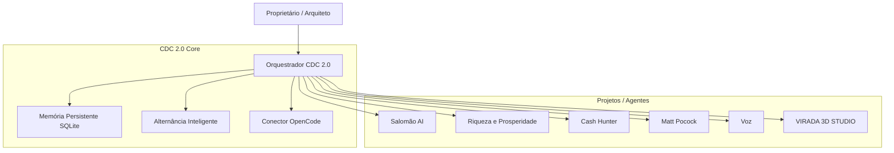

# Visão Geral da Arquitetura CDC 2.0

O CDC 2.0 foi projetado como um sistema de coordenação inteligente, onde um **Orquestrador Central** gere múltiplos agentes especializados e projetos, garantindo continuidade, memória e foco adaptativo.

## Diagrama de Blocos Simplificado

## Componentes Chave

1.  **Orquestrador Central:** Gerencia o ciclo de vida, prioridades e execução dos 6 projetos.
2.  **Memória Persistente:** Banco de dados SQLite centralizado que armazena estados, contextos e decisões de cada projeto.
3.  **Alternância Inteligente:** Algoritmo que decide qual projeto recebe foco do orquestrador baseado em prioridade, disponibilidade de recursos e maturidade das entregas.
4.  **Conector OpenCode:** Interface direta com o ambiente de desenvolvimento, permitindo leitura de arquivos, execução de ferramentas e gestão de sessões.

## Princípios de Design

*   **Desacoplamento:** Projetos operam independentemente, conectados apenas ao orquestrador.
*   **Persistência de Contexto:** Nenhuma informação é perdida entre sessões.
*   **Determinação:** O sistema busca validar suas próprias decisões e estados.
