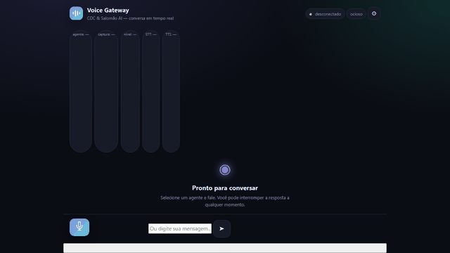

# Voice Gateway — Showcase

**Fala→texto local com Whisper, TTS, push-to-talk.**

## O que é
Gateway de voz que captura áudio via microfone, transcreve localmente com Whisper e responde via TTS. Push-to-talk: pressione o botão, fale, solte para transcrever.

## Demonstração Visual



## Rodar em 3 comandos

```bash
# 1. Instalar dependências
pip install faster-whisper soundcard numpy

# 2. Rodar o gateway
python -m voice_gateway.operar iniciar

# 3. Abrir no navegador
# http://127.0.0.1:8765
```

## Testes

```bash
python -m voice_gateway.tests.run_all
```

## Evidência de funcionamento
- 89 testes automatizados PASS (ver `HANDOFF.md` do Voice Gateway)
- Transcrição local com Whisper (`small` model, 16kHz, VAD)
- TTS via Web Speech API (browser) ou VoiceStudio (local)

## Arquitetura
- **STT:** faster-whisper (local, GPU/CPU)
- **TTS:** browser (speechSynthesis) ou local (VoiceStudio)
- **VAD:** Detecção de voz com limiar adaptativo
- **Push-to-talk:** Botão para captura manual

---

*Nota: Este showcase contém apenas código saneado para demonstração pública. Nenhum token, caminho local ou e-mail está incluído.*